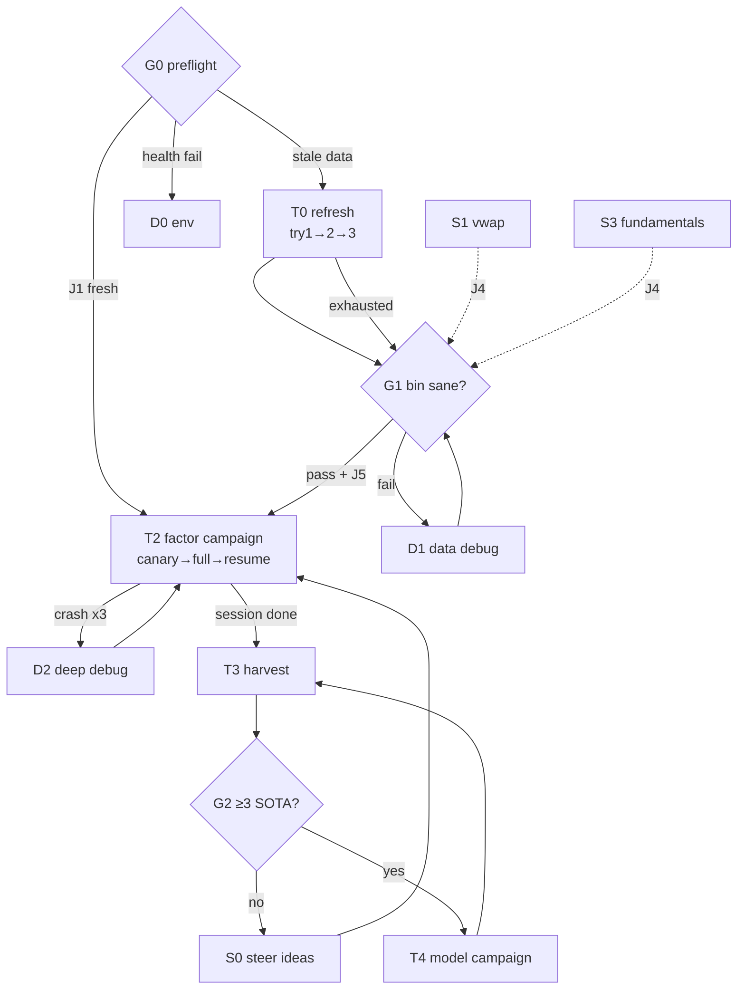

# TW TODO Graph — executable, branching roadmap

Not a linear list. **How to run it:** evaluate the global jump rules, then walk from `G0` to the
first node that isn't `[x]`, follow its edges. Update markers in the same commit as the work.

Legend — nodes: `G` gate (decision) · `T` main-line task · `S` side quest (parallel-safe) ·
`D` debug branch. Status: `[ ]` todo · `[~]` in progress · `[x]` done · `[!]` blocked · `[>]`
skipped by jump rule. Roles/models per node refer to AGENT_PLAYBOOK.md. `risky` = Architect
required before code. IDs are sparse (T1/T5 retired in drafting) — gaps are normal, never
renumber.

## Global jump rules (check before picking any node)

- **J1** Bin calendar fresh (last line of `~/.qlib/qlib_data/tw_data/calendars/day.txt` = last
  TPE trading day) **and** no schema change since last G1 pass → skip T0, go G1-lite (just
  `_verify_bin`) → T2.
- **J2** Session has <1 hour of attention → only G0 + T3 (harvest). **Never launch loops** (they
  run for days).
- **J3** Data corruption discovered anywhere → halt everything → D1.
- **J4** After ANY bin-schema change (S1/S3 or collector edits) → forced partial T0 (re-dump bin
  + regenerate `daily_pv.h5` — pitfall: `FIELDS` sync) → full G1 before any loop.
- **J5** Loops (T2/T4) are blocked unless Jans has approved the LLM spend this session (CLAUDE.md
  rule 5). No gate overrides this.
- **J6** Upstream security/bugfix urgently needed → T6 out of band.

## Main line

### `[ ]` G0 · Preflight — PM + Scout (Haiku)
Checks: repo clean (`git status`) · `.env` present · data age (calendar tail vs today) ·
`rdagent health_check` passes (Jans runs).
Edges: all pass + data stale → **T0** · all pass + J1 → **T2** · health fail → **D0** · dirty
repo → resolve/commit first (PM).

### `[ ]` T0 · Data refresh — Jans (machine); Scribe monitors log
Entry: G0 pass. Runtime 15–40 min.
- **try 1**: `bash rdagent/scenarios/qlib/tw_data/daily_update.sh`
- **try 2**: isolate the failing dataset from the log → re-run `collect_finmind` with `--skip_*`
  for everything else (per-day cache makes re-runs cheap) → resume chain from step 2 (clean).
- **try 3**: `END=$(date -d yesterday +%F)` (FinMind same-day lag) — or skip collection entirely
  and rebuild `dump_to_bin` + `dump_factor_h5` from the existing clean CSVs.
- **exhausted** → mark `[>]`, proceed on stale data: verify test_end auto-trim, flag staleness in
  PROJECT_STATE → G1. Token/quota dead → **D3** as well.

### `[ ]` G1 · Bin sanity gate — Jans runs; Scout reads output
`_verify_bin.py` + `_smoke_qlib.py` (add `_smoke_qrun_tw.py` after schema changes).
Pass → T2 (or T4 if that's the campaign). Fail → **D1**. Three failed fix cycles → escalate
Architect (`risky`).

### `[ ]` T2 · Factor campaign — Jans launches; PM decides; Scout monitors
Entry: G1 `[x]` **and** J5 cleared.
- **try 1**: canary — wrapper with `--loop_n 1`; inspect one full cycle end-to-end.
- **try 2**: full session via `_run_factor_tw.sh` (tmux).
- **try 3**: after any crash — **resume, never restart**:
  `--path "log/<session>/__session__/<loop>/<step>"` (fresh restarts lose the trace/SOTA state).
In-run conditions (Scout watches `logs/factor_tw_latest.log`):
- log mtime frozen >30 min, process `S`-state → known httpx deadlock → kill; confirm
  `CHAT_STREAM=false`; → try 3.
- `IndexError` in `get_step_time` → recompute `QLIB_FACTOR_TW_TEST_END` (penultimate calendar
  day) → try 3.
- repeated LLM 4xx/5xx → **D0**, then return.
- ≥3 crashes at the same loop index → **D2**.
Exit: ≥1 completed session → **T3** (T2 may keep running in parallel).

### `[ ]` T3 · Harvest — Scout (Haiku) extracts; Scribe writes
Entry: any completed T2/T4 session in `log/`. Cheap; do it even under J2.
Extract per-factor: hypothesis, IC/RankIC/ICIR, SOTA-or-not, cost → write/append
`docs/tw/FINDINGS.md` (create on first run; newest campaign on top). → **G2**.

### `[ ]` G2 · SOTA gate — PM
≥3 robust SOTA factors in FINDINGS? Yes → **T4** unlocked (S1/S3 also gain priority — better
data beats more loops). No → **S0** then back to **T2**.

### `[ ]` S0 · Steer — Jans owns; PM assists
Edit `data/factor_ideas.md` (local-only file) with directions the harvest suggests. Live-re-read
each iteration — **no loop restart needed**. → T2.

### `[ ]` T4 · Model campaign — same shape as T2
Entry: G2 `[x]` + J5. Env prefix `QLIB_MODEL_TW_`; entry `model_tw.py`.
Constraint: only known-good families (LGB / XGB / Linear / Transformer_ts per
MODEL_SMOKE_RESULTS.md); wanting more → **S2 first**. Same try-ladder and in-run conditions as
T2. Exit: harvest results → append FINDINGS → PM decides combined-SOTA next steps.

## Side quests (parallel-safe; run while loops execute; one Implementer each)

### `[ ]` S1 · Real VWAP — Implementer (Sonnet)
`ohlcv.csv` has `$amount`; compute VWAP=amount/volume in `dump_to_bin.py` (replace OHLC4 proxy).
Exit: **J4 forced** (bin+H5 regen, G1).

### `[ ]` S2 · Model-sweep fixes — Implementer (Sonnet)
Fix kwarg mismatches (CatBoost/DEnsemble/MLP) in `_smoke_models_tw.py`; retest ts-models on full
universe; update MODEL_SMOKE_RESULTS.md. Unblocks wider T4.

### `[ ]` S3 · Fundamentals into bin — `risky` (schema design) — Architect then Implementer
Pivot curated `type` values from long-format `fs_*.csv` into bin features. Exit: **J4 forced**.

### `[ ]` S4 · Broker/news alt-data — entry: only if Jans prioritizes — `risky`
Productionize the exploratory pulls (`data/_brokers_pull_*.log`, `_news_download.log`) into
collector datasets + cleaning rules + DECISIONS entry.

## Maintenance

### `[ ]` T6 · Upstream sync — trigger: monthly or J6 — `risky`
- **try 1**: `git fetch upstream && git merge upstream/main` — clean merge.
- **try 2**: conflicts → Architect maps each conflict against the patched-files list (CLAUDE.md)
  → targeted resolution.
- **try 3**: `git merge --abort`; cherry-pick only the needed upstream commits; retry full sync
  next cycle.
Post (always): Verifier audits every patched file still carries its hook · Jans runs smoke chain
(G1 + `_smoke_qrun_tw.py`) · broken → revert merge commit. Update merge-base note in
PROJECT_STATE.

## Debug branches

### D0 · LLM/env health — Scout → Implementer if code
`rdagent health_check` · proxy up? keys valid? · remember pitfalls: embeddings need
`encoding_format="float"`; `CHAT_STREAM=false`. Exit → return to caller node.

### D1 · Data quality — Scout diagnoses → Implementer fixes
Rules live in `data/DATA_AUDIT_REPORT.md`. Fixes go into **collector + cleaner, never hand-edit
data files** (D2 in DECISIONS). Re-run clean→bin→H5 → back to **G1**.

### D2 · Deep debug — Architect (Opus; Fable if stuck) — `risky`
Minimal repro first; check CLAUDE.md pitfalls (deadlock/9p/off-by-one have signatures). Exit
requirement: **new pitfall documented in CLAUDE.md + DECISIONS entry** — that's the deliverable,
the fix is a side effect.

### D3 · FinMind account — Jans only
Token/tier issue. If Backer/Sponsor tier lapses: collector request strategy must change
(per-stock mode) or fall back to `collect.py` (TWSE-direct) — either way, a DECISIONS entry.

## Diagram (main line)

## Update protocol

Markers move in the same commit as the work; add a dated one-liner under the node when something
non-obvious happened. Completed campaigns keep the node (flip to `[x]`, link FINDINGS section) —
history stays. Adding/removing nodes or edges = structural change → DECISIONS entry. Node IDs are
stable; never renumber.
