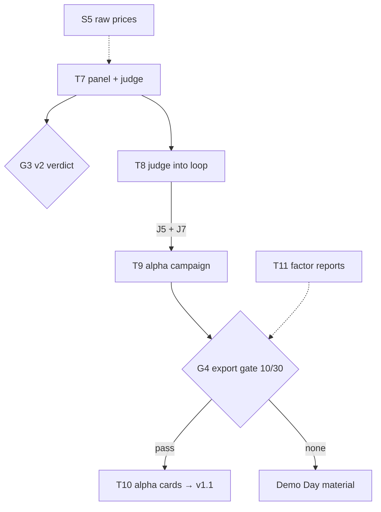
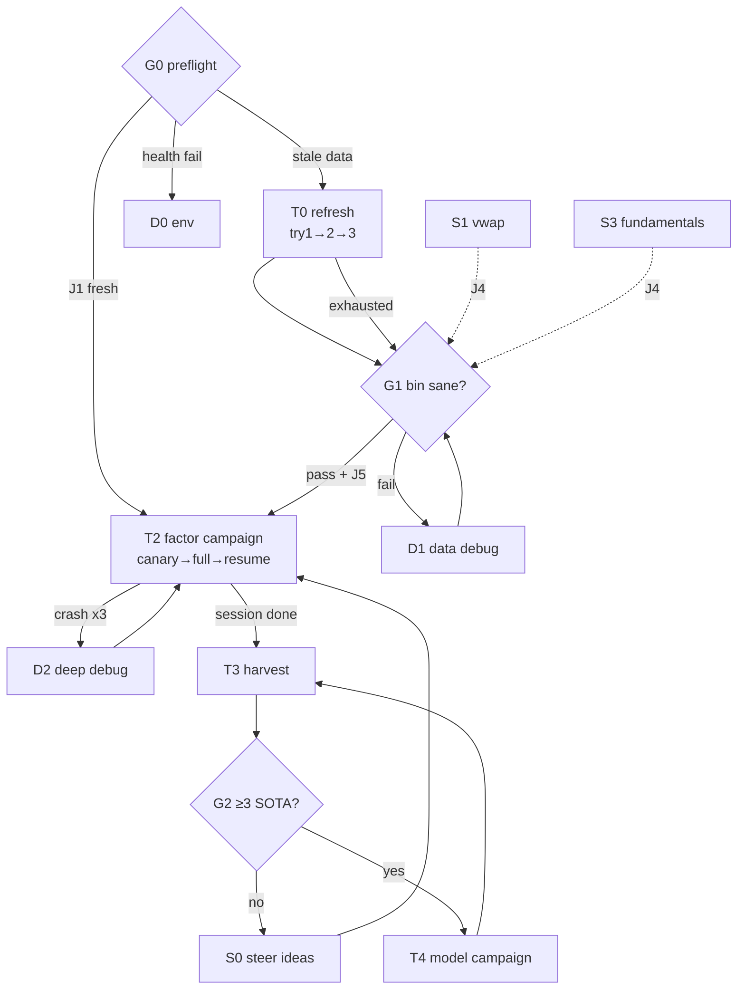

# TW TODO Graph — executable, branching roadmap

Not a linear list. **How to run it:** evaluate the global jump rules, then walk from `G0` to the
first node that isn't `[x]`, follow its edges. Update markers in the same commit as the work.

Legend — nodes: `G` gate (decision) · `T` main-line task · `S` side quest (parallel-safe) ·
`D` debug branch. Status: `[ ]` todo · `[~]` in progress · `[x]` done · `[!]` blocked · `[>]`
skipped by jump rule. Roles/models per node refer to AGENT_PLAYBOOK.md. `risky` = Architect
required before code. IDs are sparse (T1/T5 retired in drafting) — gaps are normal, never
renumber.

## Global jump rules (check before picking any node)

- **J1** Bin calendar fresh (last line of `~/.qlib/qlib_data/tw_data/calendars/day.txt` = last
  TPE trading day) **and** no schema change since last G1 pass → skip T0, go G1-lite (just
  `_verify_bin`) → T2.
- **J2** Session has <1 hour of attention → only G0 + T3 (harvest). **Never launch loops** (they
  run for days).
- **J3** Data corruption discovered anywhere → halt everything → D1.
- **J4** After ANY bin-schema change (S1/S3 or collector edits) → forced partial T0 (re-dump bin
  + regenerate `daily_pv.h5` — pitfall: `FIELDS` sync) → full G1 before any loop.
- **J5** Loops (T2/T4) are blocked unless Jans has approved the LLM spend this session (CLAUDE.md
  rule 5). No gate overrides this.
- **J6** Upstream security/bugfix urgently needed → T6 out of band.
- **J7** Before a long loop campaign (T2/T4/T9): prefer `CHAT_MODEL` `deepseek/deepseek-flash` or
  `deepseek/deepseek-v4-pro`. DeepSeek announced the end of `deepseek-chat`/`deepseek-reasoner` for
  2026-07-24, yet `deepseek-chat` still answered on 2026-10-24 (T8 canary): deprecated, not dead,
  but it can stop without notice and its serving model is unknown. Log the served model (D16).

## Main line

### `[~]` G0 · Preflight — PM + Scout (Haiku)
Checks: repo clean (`git status`) · `.env` present · data age (calendar tail vs today) ·
`rdagent health_check` passes (Jans runs).
Edges: all pass + data stale → **T0** · all pass + J1 → **T2** · health fail → **D0** · dirty
repo → resolve/commit first (PM).
- 2026-10-22: repo cleaned (July docs committed); data 5.5 months stale (calendar ends
  2026-05-08); FinMind token rejected → T0 blocked on **D3**. health_check not run.
- 2026-10-23: token and data done (T0, G1). Still open: `rdagent health_check`, which needs the
  retired `deepseek-chat` model name replaced first (J7/D0).
- 2026-10-24: correction: `deepseek-chat` still answers (the T8 canary used it), so it does not
  block health_check; switching is still advised (J7).

### `[x]` T0 · Data refresh — Jans (machine); Scribe monitors log
Entry: G0 pass. Runtime 15–40 min.
- **try 1**: `bash rdagent/scenarios/qlib/tw_data/daily_update.sh`
- **try 2**: isolate the failing dataset from the log → re-run `collect_finmind` with `--skip_*`
  for everything else (per-day cache makes re-runs cheap) → resume chain from step 2 (clean).
- **try 3**: `END=$(date -d yesterday +%F)` (FinMind same-day lag) — or skip collection entirely
  and rebuild `dump_to_bin` + `dump_factor_h5` from the existing clean CSVs.
- **exhausted** → mark `[>]`, proceed on stale data: verify test_end auto-trim, flag staleness in
  PROJECT_STATE → G1. Token/quota dead → **D3** as well.
- 2026-10-22: blocked on D3. Collector hardened for the catch-up (D13/D14); after a gap this
  long use the RUNBOOK §1 catch-up (`--refresh_ohlcv`), not plain `daily_update.sh`.
- 2026-10-23: done. Catch-up + one `daily_update.sh` run → data through 2026-10-22 (bin: 3,041
  instruments, 4,103 days). Fixed on the way: OOM in long-format merges (now streamed), gov_bank
  never collected (renamed dataset), ETF codes mangled by `dump_to_bin`, anchor check now also
  covers the day before. Logs: `data/_catchup_20261022.log`, `data/_daily_update_20261023.log`.

### `[x]` G1 · Bin sanity gate — Jans runs; Scout reads output
`_verify_bin.py` + `_smoke_qlib.py` (add `_smoke_qrun_tw.py` after schema changes).
Pass → T2 (or T4 if that's the campaign). Fail → **D1**. Three failed fix cycles → escalate
Architect (`risky`).
- 2026-10-23: pass. `_verify_bin` 21/21 non-null; new-window checks: no seam at the old cache
  edge, coverage ≥ the prior six months, no duplicate keys, no NaN drift, H5 and qlib read
  2026-10-22. Note `_smoke_qlib.py` tests the legacy `tw_daily_mini.h5`, not the bin.

### `[ ]` T2 · Factor campaign — Jans launches; PM decides; Scout monitors
Entry: G1 `[x]` **and** J5 cleared.
- **try 1**: canary — wrapper with `--loop_n 1`; inspect one full cycle end-to-end.
- **try 2**: full session via `_run_factor_tw.sh` (tmux).
- **try 3**: after any crash — **resume, never restart**:
  `--path "log/<session>/__session__/<loop>/<step>"` (fresh restarts lose the trace/SOTA state).
In-run conditions (Scout watches `logs/factor_tw_latest.log`):
- log mtime frozen >30 min, process `S`-state → known httpx deadlock → kill; confirm
  `CHAT_STREAM=false`; → try 3.
- `IndexError` in `get_step_time` → recompute `QLIB_FACTOR_TW_TEST_END` (penultimate calendar
  day) → try 3.
- repeated LLM 4xx/5xx → **D0**, then return.
- ≥3 crashes at the same loop index → **D2**.
Exit: ≥1 completed session → **T3** (T2 may keep running in parallel).

### `[ ]` T3 · Harvest — Scout (Haiku) extracts; Scribe writes
Entry: any completed T2/T4 session in `log/`. Cheap; do it even under J2.
Extract per-factor: hypothesis, IC/RankIC/ICIR, SOTA-or-not, cost → write/append
`docs/tw/FINDINGS.md` (create on first run; newest campaign on top). → **G2**.

### `[ ]` G2 · SOTA gate — PM
≥3 robust SOTA factors in FINDINGS? Yes → **T4** unlocked (S1/S3 also gain priority — better
data beats more loops). No → **S0** then back to **T2**.

### `[ ]` S0 · Steer — Jans owns; PM assists
Edit `data/factor_ideas.md` (local-only file) with directions the harvest suggests. Live-re-read
each iteration — **no loop restart needed**. → T2.

### `[ ]` T4 · Model campaign — same shape as T2
Entry: G2 `[x]` + J5. Env prefix `QLIB_MODEL_TW_`; entry `model_tw.py`.
Constraint: only known-good families (LGB / XGB / Linear / Transformer_ts per
MODEL_SMOKE_RESULTS.md); wanting more → **S2 first**. Same try-ladder and in-run conditions as
T2. Exit: harvest results → append FINDINGS → PM decides combined-SOTA next steps.

## Side quests (parallel-safe; run while loops execute; one Implementer each)

### `[ ]` S1 · Real VWAP — Implementer (Sonnet)
`ohlcv.csv` has `$amount`; compute VWAP=amount/volume in `dump_to_bin.py` (replace OHLC4 proxy).
Exit: **J4 forced** (bin+H5 regen, G1).
- 2026-10-22: **do not implement as written.** `$amount`/`$volume` are raw while `ohlcv.csv`
  prices are back-adjusted, so amount/volume is off by the adjustment factor (2330 on
  2021-06-01: 596.9 vs adjusted close 545.3). Needs raw closes → S5 (DECISIONS D17).

### `[ ]` S2 · Model-sweep fixes — Implementer (Sonnet)
Fix kwarg mismatches (CatBoost/DEnsemble/MLP) in `_smoke_models_tw.py`; retest ts-models on full
universe; update MODEL_SMOKE_RESULTS.md. Unblocks wider T4.

### `[ ]` S3 · Fundamentals into bin — `risky` (schema design) — Architect then Implementer
Pivot curated `type` values from long-format `fs_*.csv` into bin features. Exit: **J4 forced**.

### `[ ]` S4 · Broker/news alt-data — entry: only if Jans prioritizes — `risky`
Productionize the exploratory pulls (`data/_brokers_pull_*.log`, `_news_download.log`) into
collector datasets + cleaning rules + DECISIONS entry.

## Alpha factory line (AI CUP 2026)

Design: `docs/tw/ALPHA_FACTORY.md`. Runs beside the main line; contest dates bind (freeze 10/23,
contest 10/27–11/27, v1.1 on 11/2). RD-Agent never enters the contest's daily path.

### `[x]` T7 · Alpha panel + fast judge — Implementer
`tw_data/dump_alpha_panel_tw.py` (point-in-time 150 universe, VWAP, revenue known on the 10th) +
`tw_data/alpha_eval_tw.py` (RankIC, top-24 book with contest costs, 24-day windows, gate).
- 2026-10-22: built; `_smoke_alpha_eval_tw` 15/15. First panel from the May clean data: 301
  stocks, 2019-01 → 2026-05-08, exact VWAP on 65% of universe rows; the May selection already
  matches 141/150 of the official list. Remaining: rebuild after the catch-up (phase 1 clean +
  phase 2 revenue) with `--raw_ohlcv` and `--official_list`; check overlap at 2026-07-31.
- 2026-10-23: rebuilt on data through 2026-10-22 (May build kept in `data/alpha_tw_2026-05-08/`).
  The 2026-07-31 selection first matched 141/150: 8 misses were 2025–26 listings that
  `stock_info.csv` still called emerging. Now ranks by index weight from 2024-10 and dates
  listings by first index weight (D19): 149/150; the miss is 3718, 5371's new holding company.
  Smoke test 18/18. Exact VWAP on 61% of universe rows (raw closes end 2026-05-05 → S5).

### `[x]` G3 · v2 hypotheses verdict — PM
Run the baselines on research + holdout; hand results to the contest team (they own v2's gates).
- 2026-10-22 (May data): none passes the strict gate; `rev_accel` positive in both windows;
  momentum negative before mid-2025, strong after (beta 1.7); 投信 flow unsupported. Table in
  ALPHA_FACTORY §6. Redo on the refreshed panel → `[x]`.
- 2026-10-23 (data to 2026-10-22): `rev_accel` is the one candidate (research t 2.7/2.2 at 1/5
  days; holdout t 4.6 at 20 days, 78% of 24-day windows won). Momentum's holdout edge faded
  with five more months (t 4.0 → 1.8). 投信 flow still nothing. Handoff to the team: Jans.

### `[x]` T8 · Judge into the loop — `risky` — Architect then Implementer
New `alpha_tw` loop: scenario text (contest rules, pods, panel fields; no tickers/dates), runner
subclass calling `evaluate()` instead of qrun (no Docker), feedback subclass with `gate()` in code,
alpha-card writer, reject check for stock-code/date literals, entry `app/qlib_rd_loop/alpha_tw.py`
+ `AlphaTwBasePropSetting` (prefix `QLIB_ALPHA_TW_`). Decide T6 first. Exit: canary `--loop_n 1`
(needs J5, J7).
- 2026-10-24: built (D20); T6 turned out not to block it (no qrun/Docker). Smoke 20/20. Canary
  (Jans approved one round): 1 loop in 4 min, 28 LLM calls, ~$0.03; 4 factors, none passed. Best:
  revenue surprise vs own year (t 3.32 at 1d, 2.30 at 5d, 1.83 at 20d). Run with
  `conda activate rdagent` (the coder needs `CONDA_DEFAULT_ENV`), `.env` sourced, `CHAT_STREAM=false`.

### `[ ]` T9 · Alpha campaign — Jans launches; PM steers per pod
Research window only. Entry: T8 `[x]` + J5 + J7. Same try-ladder as T2.
- 2026-10-24: Jans asked for 10 rounds on the new split (D21), library seeded with the traded
  signals (D22). The first launch crashed entering round 2 (upstream history template; fixed by
  `proposal/alpha_proposal_tw.py`, smoke check 11). The relaunch ran rounds 0–7 in 34 min, 180
  calls, ~$0.46 by LiteLLM (per round $0.03 → $0.08 as the history grows), then DeepSeek answered
  "Insufficient Balance" in round 8. 25 factors proposed, 24 judged, 1 passed:
  `EarningsRevision_x_Cheapness_30_70` (0.7 × rank of 1/PE + 0.3 × rank of `$rev_accel`; t 3.91 at
  5 days, max seed correlation 0.18). Chips (10 factors) all failed; 3 revenue variants were
  blocked by the seeds (correlation 0.72–0.81). Report: Claude Doc "RD-Agent 因子研究十輪試跑報告".
  Resumed after Jans's top-up (20:58) with `alpha_tw.py --path
  log/alpha_tw_r10_20261024_1151/__session__/7/4_record --loop_n 10`: on a resume `loop_n` counts
  the finished rounds too, and a first try with `--loop_n 2` ran nothing (CLAUDE.md pitfall).
  Rounds 8–9 (5.6 min, $0.15) built on the accepted card: 4 of 5 were rev_accel × value/low-vol
  composites. `RevAccel_x_DivYield_50_50` had the campaign's best research t (5.25 at 5 days) but
  correlation 0.63 with both the accepted card and `traded_rev_accel`. Totals: 30 proposed, 29
  judged, 1 pass, 0 confirmed; ~$0.58 for the 10 rounds (~$0.63 with the crash and the stall).
- 2026-10-25 03:36: flash campaign (Jans: every step on `deepseek-flash`, run until the balance is
  gone; $1.92 at the start). Continues the 10-round session into `log/alpha_tw_flash_20261025`
  (`--checkout_path`), with `CHAT_MODEL`/`LITELLM_CHAT_MODEL` set to `deepseek/deepseek-flash` and
  an empty `*_CHAT_MODEL_MAP` exported after `.env`. The proposal history now keeps the last 10
  trials in full and older ones as one line per factor, so a long run's prompts stay bounded.
  Ended 08:29 when the balance hit −$0.01 (billed $1.93; LiteLLM said $1.18). Rounds 10–29: 57
  proposed, 48 judged (9 never produced values, vs 1/30 before), 11 passed, ~14.6 min and ~$0.10
  per round (round 24: 59 min, 109 calls). Round 29 passed 4 window variants of one idea
  (correlation 0.72–0.92 with each other): same-round passes were never compared, now fixed
  (`alpha_runner_tw.dedupe_round`, D23). Report: Claude Doc "RD-Agent 因子研究 flash 長跑報告".

### `[ ]` G4 · v1.1 export gate — PM, by 2026-10-30
Research-gate passes → holdout confirmation (script outside the loop, once per batch) → T10. None
pass → keep the library for Demo Day; v1.1 ships without new alphas.
- 2026-10-24: first candidate not confirmed: `EarningsRevision_x_Cheapness_30_70` holdout t 1.3 at
  5 days (< 2). Its top-24 book still beat B0 by +30.6%/yr on the holdout, but with beta 0.49 and
  mostly in the July drop; plain 1/PE did better. Kept in the library, not exported.
- 2026-10-25: all 12 cards checked (`data/alpha_tw/holdout_report.json`). Confirmed:
  `LiquiditySize_Rank_20d` (holdout t 3.09, +42%/yr, beta 1.20; gains mostly May–June) and
  `SalesYield_LiquiditySize_70_30` (t 2.63, +58.6%/yr, beta 0.72). Momentum-type cards reversed
  (industry-relative strength consistency t −1.4 to −2.8). These two are the only export candidates.
- 2026-10-25 (D24): no export without an `ALPHA_REVIEWS.md` entry. Both reviewed:
  `LiquiditySize_Rank_20d` is a size tilt (correlation 0.94 with log market value; a team decision,
  not an alpha); `SalesYield_LiquiditySize_70_30` is mostly sales yield, a value/defensive candidate
  pending a trailing-12-month revenue version and an industry cap.

### `[ ]` T10 · Export alpha cards — Implementer + contest team
Plain pandas functions + YAML cards (ALPHA_FACTORY §9) into AI-cup-etf-agent through a PR; new
`code_version`; only fields with a live source.

### `[x]` T11 · Formal factor report — Implementer (Claude)
Every factor handed to the team or the decision model (大腦) ships as `tw-factor-report/1`
(`docs/tw/FACTOR_REPORT.md`, D32): generator `tw_data/factor_report_tw.py`, teammate prompts for
stage 1 (declaration, before results) and stage 2 (interpretation), declarations in
`docs/tw/factor_reports/`. Feeds G4/T10: a card exported in T10 should come with its report.
- 2026-10-26: built. Reproduces the judge on all five input paths (rev_accel t 3.45 / +1.22%,
  SalesYield card 3.15 / +0.40%, lowvol60 CSV 0.76, idea B5 1.71 at 20 days = team_ideas.json).
  Example `docs/tw/factor_reports/rev_accel.yaml`. Next: reports for the two confirmed cards; the
  spec and prompts into the contest repo for teammates; the decision model's prompt reads
  `report.json` by the FACTOR_REPORT §4 rules.
- 2026-10-26 (evening): reports and second A–F reviews for both confirmed cards (ALPHA_REVIEWS).
  Both read as style tilts (cap 20%): large + liquid adds ~nothing to a top-24 book in research;
  sales yield works only in down markets and only in the smaller half. Reviewer holdout notes
  stay out of report.json (`holdout_notes`).

### `[ ]` S5 · Raw `TaiwanStockPrice` → exact VWAP — `risky` (collector)
Collect raw daily prices (by date, ~4.4K calls) so VWAP is exact everywhere and FinMind's adjusted
prices can be rebuilt with our own `$factor` (DECISIONS D13 deferred, D17). Supersedes S1.

### `[ ]` S6 · Tournament rules → contest ranking module — Jans + team
Port ALPHA_FACTORY §8 (cover when ahead, separate when behind; beta is a market bet) into the
v2 plan and the ranking module.

## Maintenance

### `[~]` T6 · Upstream sync — trigger: monthly or J6 — `risky`
- 2026-10-22: upstream v1.0.0 fetched (15 commits, mostly security). Trial merge clean; only
  overlap `utils/env.py`, TW patch intact. Awaiting Jans's go-ahead; TW follow-ups listed in
  PROJECT_STATE (ret.parquet in TW templates, signed pickles vs old `log/` sessions).
- **try 1**: `git fetch upstream && git merge upstream/main` — clean merge.
- **try 2**: conflicts → Architect maps each conflict against the patched-files list (CLAUDE.md)
  → targeted resolution.
- **try 3**: `git merge --abort`; cherry-pick only the needed upstream commits; retry full sync
  next cycle.
Post (always): Verifier audits every patched file still carries its hook · Jans runs smoke chain
(G1 + `_smoke_qrun_tw.py`) · broken → revert merge commit. Update merge-base note in
PROJECT_STATE.

## Debug branches

### D0 · LLM/env health — Scout → Implementer if code
`rdagent health_check` · proxy up? keys valid? · remember pitfalls: embeddings need
`encoding_format="float"`; `CHAT_STREAM=false`. Exit → return to caller node.
- 2026-10-22: DeepSeek retired `deepseek-chat`/`deepseek-reasoner` on 2026-07-24 (announced
  2026-04-24; they mapped to V4-Flash until then). PROJECT_STATE records the loop on
  `deepseek/deepseek-chat`, so the next loop will fail until Jans switches `CHAT_MODEL` (and any
  LiteLLM map) to `deepseek-flash` or `deepseek-v4-pro`. `deepseek-flash` follows the latest model.
- 2026-10-24: that prediction was wrong: the T8 canary ran 26 calls on `deepseek/deepseek-chat` and
  2 on `deepseek/deepseek-v4-pro` (via `LITELLM_CHAT_MODEL_MAP`), all answered. See J7.

### D1 · Data quality — Scout diagnoses → Implementer fixes
Rules live in `data/DATA_AUDIT_REPORT.md`. Fixes go into **collector + cleaner, never hand-edit
data files** (D2 in DECISIONS). Re-run clean→bin→H5 → back to **G1**.
- 2026-10-23: open universe question for Jans: 興櫃 emerging-board stocks (no price limit, thin
  trading) are ~390 of 3,041 bin instruments by latest `stock_info` records and cause 93% of the
  >10.5% daily moves. FinMind prices also include the pre-listing emerging months of
  later-listed stocks. For dating board membership, see the next note (not `stock_info`).
- 2026-10-23 (alpha factory): careful — `stock_info.csv` board records carry FinMind's record
  date, not the change date (7769 listed Jan 2026 but stays "emerging" until the 2026-10-22
  record; 6472 on TWSE since ≤ 2024-10 but recorded TPEx). First appearance in
  `market_value_weight.csv` dates listings from 2024-10-30 (D19, `select_universe`).

### D2 · Deep debug — Architect (Opus; Fable if stuck) — `risky`
Minimal repro first; check CLAUDE.md pitfalls (deadlock/9p/off-by-one have signatures). Exit
requirement: **new pitfall documented in CLAUDE.md + DECISIONS entry** — that's the deliverable,
the fix is a side effect.

### D3 · FinMind account — Jans only
Token/tier issue. If Backer/Sponsor tier lapses: collector request strategy must change
(per-stock mode) or fall back to `collect.py` (TWSE-direct) — either way, a DECISIONS entry.
Per-stock mode alone can't replace it: `TaiwanStockPriceAdj` is Sponsor-only even per stock
(verified 2026-10-22), so a lapsed tier means losing adjusted prices.
- 2026-10-22: "Token is illegal" — token rotated/revoked. Fix: log in at finmindtrade.com, copy
  the current API token into `FINMIND_TOKEN_API_KEY` in `.env`, confirm the tier.
- 2026-10-23: resolved — new token, account level 3 (Sponsor), 6,000 calls/hour (rolling).

## Diagram (main line)

## Update protocol

Markers move in the same commit as the work; add a dated one-liner under the node when something
non-obvious happened. Completed campaigns keep the node (flip to `[x]`, link FINDINGS section) —
history stays. Adding/removing nodes or edges = structural change → DECISIONS entry. Node IDs are
stable; never renumber.
